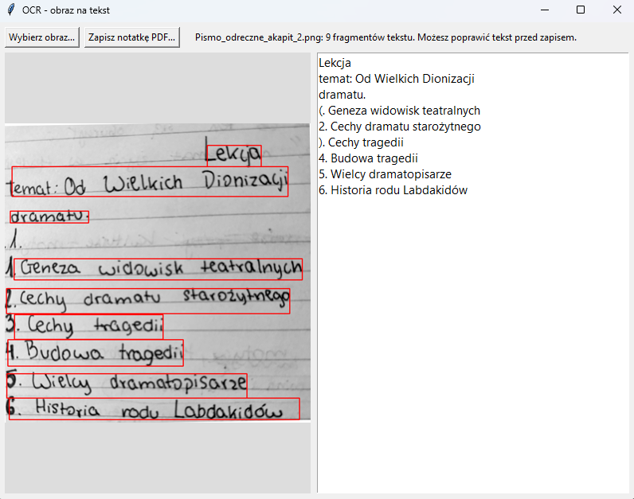

# OCR – obraz na tekst (druk i pismo odręczne, PL/EN)

Projekt z przedmiotu **Techniki multimedialne (2026Z)**. Program zamienia zdjęcie lub skan strony na tekst. Rozpoznaje **tekst drukowany oraz pismo odręczne (kursywę)** w języku **polskim i angielskim**. Alfabet modelu ma 93 znaki: litery polskie i angielskie, cyfry, interpunkcję i spację.



## Jak to działa

Potok ma dwa etapy: **wyodrębnienie linii tekstu** (OpenCV/NumPy) i **rozpoznanie linii** siecią neuronową.

### 1. Wyodrębnianie tekstu (`code/imageoperations/preprocessing.py`)

1. **Binaryzacja:** rozmycie Gaussa i binaryzacja adaptacyjna (odporna na cień), potem usunięcie drobnego szumu.
2. **Prostowanie strony:** profil projekcji poziomej dla kątów ±5°. Wybierany jest kąt, przy którym linie tekstu są najbardziej poziome.
3. **Czyszczenie maski:** usunięcie linii zeszytu, marginesu, krawędzi kartki i cieni. Kryteria: jasność względem papieru i długie proste odcinki (operacje morfologiczne).
4. **Podział na linie:** każda linia tworzy maksimum w profilu poziomym. Granica jest w najgłębszym minimum między liniami, więc **wycinki nigdy na siebie nie nachodzą**.
5. **Normalizacja linii:** wyrównanie oświetlenia, usunięcie fragmentów sąsiednich linii, przycięcie do tuszu i skalowanie do wysokości 64 px. Ta sama funkcja działa w treningu i przy rozpoznawaniu.

### 2. Rozpoznawanie (`code/model/crnn.py`)

Sieć **CRNN + CTC**, zbudowana od zera w PyTorch, bez pretrenowanych wag:
- **Część splotowa:** 6 bloków resztkowych, czyli 16 warstw splotowych z BatchNorm, LeakyReLU i Dropout2d. Rozmiar zmniejsza krok splotu, bez poolingu.
- **Część rekurencyjna:** 2-warstwowy dwukierunkowy LSTM (256 neuronów w każdym kierunku).
- **Wyjście:** warstwa liniowa na 94 klasy (93 znaki + blank CTC).
- **Rozmiar:** ok. 4,7 mln parametrów (wariant `--base 32`).

Sieć czyta całą linię naraz. Dzięki stracie CTC sama uczy się, gdzie stoi która litera, więc obrazu nie trzeba dzielić na pojedyncze znaki, co dla kursywy nie działa. Dekodowanie zachłanne CTC i metryka CER (odległość Levenshteina) są zaimplementowane samodzielnie (`code/train/metrics.py`).

## Dane i trening

**Zbiór uczący:**
- **IAM-line:** 10 373 linie angielskiego pisma odręcznego, oficjalny podział z rozłącznymi autorami w teście.
- **Syntetyczny druk:** 14 500 linii wygenerowanych z polskich i angielskich tekstów, 43 kroje pisma, zniekształcenia.
- **Własne pismo:** 243 ręcznie opisane linie polskich notatek (2 osoby), zdjęcia z telefonu.

W treningu działa augmentacja upodabniająca dane do zdjęć z telefonu: deformacje elastyczne, pochylenie, cień i szare tło, linie zeszytu, JPEG i niska rozdzielczość.

**Trening odbył się w Google Colab** (`notebooks/colab_train.ipynb`):

| Etap | Epoki | Val CER | Val dokładność linii |
|---|---|---|---|
| Trening bazowy (IAM + druk) | 34 | ≈ 2,7% | ≈ 66% |
| Dotrenowanie na własnym piśmie (`--finetune`, lr 1e-4, linie własne ×10) | 40 | ≈ 2,5% | ≈ 67% |

CER liczony jest na wspólnym zbiorze walidacyjnym (druk + IAM + własne pismo). Log treningu podaje też CER osobno dla każdego źródła. Przebieg treningu: [bazowy](photos/training_curves_epochs_40.png), [dotrenowanie](photos/training_curves_finetune.png).

## Uruchomienie

Wymagany Python 3.10+.

```bash
pip install -r code/requirements.txt
```

Na Windowsie z kartą NVIDIA zainstaluj PyTorcha z CUDA, np. `pip install torch --index-url https://download.pytorch.org/whl/cu128`. Do samego GUI wystarczy wersja na procesor.

**Wytrenowane modele (`*.pth`) nie są w repozytorium.** Umieść plik `best_crnn.pth` w `code/train/checkpoints_finetune/`. Jeśli go tam nie będzie, GUI przy starcie zapyta o plik.

### GUI

```bash
python GUI/gui.py
```

Wybierz zdjęcie (`.png`/`.jpg`). Program zaznaczy wykryte linie, pokaże rozpoznany tekst do ręcznej poprawy i zapisze go jako notatkę PDF.

### Z linii poleceń (z katalogu `code/`)

```bash
python imageoperations/inference.py --image strona.jpg --checkpoint train/checkpoints_finetune/best_crnn.pth --debug ramki.png
python imageoperations/inference.py --image linia.png --line      # obraz z jedną linią
```

## Przygotowanie danych i trening (z katalogu `code/`)

Folder `dataset/` nie jest w repozytorium. Tworzą go skrypty:

```bash
python downloadiam.py             # IAM-line z Hugging Face -> ../dataset/handwritten
python prepareenglishprinted.py   # teksty polskie (Wolne Lektury) -> ../dataset/books
python createprintedpngs.py       # syntetyczny druk -> ../dataset/printed (fonty w code/fonts/)
python mergeexcels.py             # wspólny ../dataset/labels.csv ze wszystkich źródeł
python train/train.py --base 32 --ckpt-dir train/checkpoints_base32
```

Fontów (`code/fonts/`) nie ma w repozytorium ze względu na licencję. Skopiuj do tego folderu dowolne fonty `.ttf` z polskimi znakami.

## Dotrenowanie na własnym piśmie

1. Wytnij linie ze zdjęć swoich notatek:
   ```bash
   python imageoperations/inference.py --image notatka.jpg --checkpoint train/checkpoints_base32/best_crnn.pth --export ../dataset/moje_pismo
   ```
2. Popraw tekst w `../dataset/moje_pismo/labels.csv` (kolumna `text`; puste pole oznacza pominięcie linii). Kilka stron oznacz jako `validation`/`test`.
3. Scal dane i dotrenuj model:
   ```bash
   python mergeexcels.py
   python train/train.py --finetune train/checkpoints_base32/best_crnn.pth --base 32 --ckpt-dir train/checkpoints_finetune --lr 1e-4 --oversample moje_pismo=10 --epochs 40 --patience 10
   ```

Linie IAM i druku nadal biorą udział w treningu, więc model nie traci skuteczności na innym piśmie. Kolejne osoby warto dodawać jako osobne foldery w `dataset/`, bo każdy dostaje wtedy własny CER w logach.

## Ograniczenia

- Linie pisma nachodzące na siebie wydłużeniami liter (g, y, ł) mogą zostać przycięte na granicy linii.
- Tekst w kilku kolumnach jest łączony w jedną linię.
- Wygięte linie przy grzbiecie zeszytu nie dają się wyprostować jednym kątem obrotu.
- Bardzo jasny ołówek może zostać usunięty razem z liniami zeszytu.
- Wzory matematyczne zawierają znaki spoza alfabetu (np. `=`, `+`).

## Struktura

```
GUI/gui.py                     interfejs (tkinter) + eksport PDF
code/configs/train_config.yaml alfabet modelu
code/imageoperations/          preprocessing, segmentacja, dataset, inferencja
code/model/crnn.py             sieć CRNN
code/train/                    pętla ucząca, metryki (CER, dekodowanie CTC)
code/*.py                      pobieranie i przygotowanie danych
notebooks/colab_train.ipynb    trening w Google Colab
photos/                        przykładowe wyniki i przebiegi treningu
```
